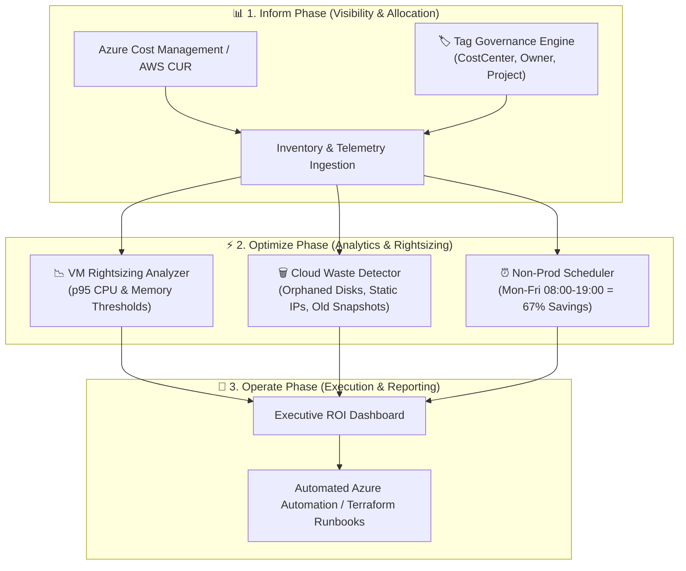

# 💰 Cloud FinOps Toolkit — Enterprise Cloud Cost Optimization & Waste Elimination

[](https://github.com/shyam-codeops/cloud-finops-toolkit/actions)
[](https://python.org)
[](https://finops.org)
[](https://azure.microsoft.com)
[](LICENSE)

An automated, enterprise-grade **Cloud FinOps Toolkit** designed to eliminate cloud waste, rightsize oversized virtual machines, enforce cost-allocation tags, and schedule non-production workloads. Aligned with the **FinOps Foundation Framework** across the *Inform*, *Optimize*, and *Operate* phases.

---

## 🏛️ FinOps Framework Architecture



---

## 💎 Core Capabilities

| Capability | Problem Solved | Realized Impact |
| :--- | :--- | :--- |
| **📉 VM Compute Rightsizing** | Over-provisioned VMs running at < 15% CPU utilization. | **30% - 60% compute cost reduction** by automatically re-mapping instances to right-sized SKUs (e.g., D4s_v5 → D2s_v5 or B-series). |
| **🗑️ Orphaned Disk Cleanup** | Managed disks detached from deleted VMs continuing to accrue storage costs. | **100% elimination of stranded storage spend** by discovering unattached disks idle for > 14 days and taking safety snapshots before purge. |
| **🌐 Idle Public IP Release** | Unassociated static public IPv4 addresses billed hourly. | **Immediate reclamation** of unused IP addresses. |
| **⏰ Off-Hours Auto-Shutdown** | Dev/Stage environments running 24/7 (168 hours/week) when engineers only work 55 hours/week. | **67.2% savings** on all non-production compute by auto-stopping workloads outside business hours (08:00 - 19:00 Mon-Fri). |
| **🏷️ Cost-Allocation Tagging** | Untagged resources causing attribution gaps and untracked budget overrun. | **Enforces 100% tag compliance** for `Environment`, `CostCenter`, `Owner`, and `Project`. |

---

## 🚀 Quickstart & Usage

### 1. Clone & Run with Zero External Dependencies
The toolkit is built using Python standard library `dataclasses`, requiring **no third-party dependencies** for evaluation:

```bash
git clone https://github.com/shyam-codeops/cloud-finops-toolkit.git
cd cloud-finops-toolkit

# Run complete unit test suite
python -m unittest discover -s tests -p "test_*.py" -v
```

### 2. Generate Executive ROI Savings Dashboard
Generate an aggregated cost reduction breakdown across rightsizing, waste elimination, and scheduling:

```bash
python -m finops_toolkit.cli summary
```

**Output:**
```text
===============================================================
   [FINOPS] CLOUD FINOPS COST OPTIMIZATION TOOLKIT
   Rightsizing | Waste Elimination | Off-Hours Scheduling
===============================================================

[*] Generating Complete FinOps Executive ROI Savings Summary...

===============================================================
           FINOPS EXECUTIVE COST REDUCTION DASHBOARD           
===============================================================
 1. VM Rightsizing & SKU Downsizing     :  $  354.00 / mo
 2. Orphaned Disk & IP Waste Cleanup    :  $  119.50 / mo
 3. Non-Prod Off-Hours Auto-Shutdown    :  $  387.43 / mo
---------------------------------------------------------------
 TOTAL MONTHLY RUN-RATE REDUCTION       :  $  860.93 / mo
 TOTAL PROJECTED ANNUAL CASH SAVINGS    :  $10331.14 / yr
===============================================================
```

### 3. Run Individual FinOps Analyzers

```bash
# Analyze VM Rightsizing Opportunities
python -m finops_toolkit.cli rightsize

# Scan for Orphaned Disks and Unused Static IPs
python -m finops_toolkit.cli waste

# Calculate Off-Hours Shutdown Savings for Non-Prod Environments
python -m finops_toolkit.cli scheduler
```

---

## 📊 Scheduling ROI Calculation

A standard 24/7 cloud resource runs **168 hours per week** (7 days × 24 hours).
By running a non-production schedule of **Monday to Friday from 08:00 to 19:00 (11 hours/day)**:

$$\text{Active Hours} = 5 \text{ days} \times 11 \text{ hours} = 55 \text{ hours/week}$$

$$\text{Savings Percentage} = \frac{168 - 55}{168} = 67.26\%$$

For a modest non-production footprint of **$2,000/month**, automated scheduling immediately saves **$1,345/month** ($16,140/year).

---

## 🐳 Docker Deployment

Run the FinOps analysis tool containerized:

```bash
docker build -t cloud-finops-toolkit:latest .
docker run --rm cloud-finops-toolkit:latest
```

---

## 👤 Author

**Shyam Singh**
* GitHub: [@shyam-codeops](https://github.com/shyam-codeops)
* Role: DevOps Engineer

---

## 📄 License
This project is licensed under the MIT License - see the [LICENSE](LICENSE) file for details.
